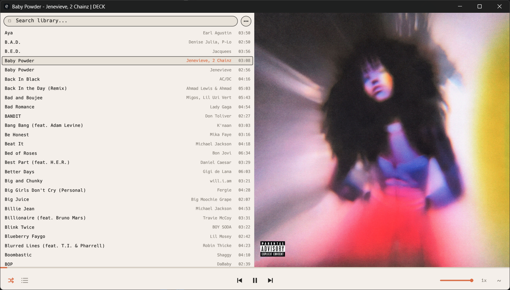

# deck

A fast, hardware-accelerated desktop audio player built with Rust and egui. Play lossless audio with real-time speed adjustments and studio reverb without needing pre-rendered edits.

## Preview

`deck` dynamically adapts its layout to your window dimensions—seamlessly transitioning between an expanded view with library management and a compact playback deck.

| Full View | Compact View |
| :---: | :---: |
|  |  |

## Features

- **Live DSP Engine**: Real-time speed scaling (sped up / slowed down) and studio hall reverb applied on the fly to high-res audio.
- **Adaptive Layout**: Smooth, dynamic UI scaling that transitions from library view to minimal deck player based on window size.
- **Hardware-Accelerated UI**: Immediate-mode GUI powered by `eframe` and `egui`.
- **Low-Latency Playback**: High-performance audio pipeline using `rodio` and `symphonia`.
- **Metadata & Album Art**: Automatic tag extraction and embedded artwork rendering via `lofty`.
- **Native Media Controls**: System integration (media keys and notifications) via `souvlaki`.

## Building from Source

Prerequisites: [Rust & Cargo](https://rustup.rs/)

```bash
git clone https://github.com/ye6isu/deck.git
cd deck
cargo run --release
```

## License

MIT © Andreu Liam Gamboa
