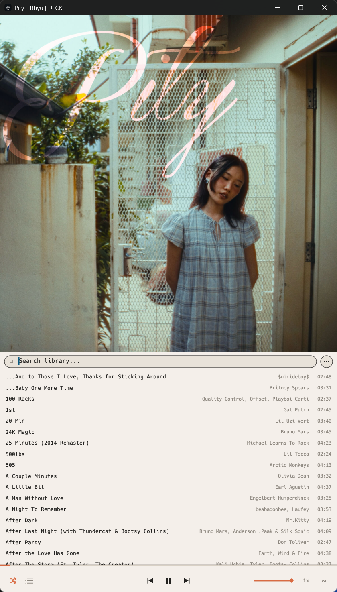

# deck

A fast, responsive desktop audio player written in Rust and egui.

## Why deck?

Instead of downloading compressed, low-bitrate "sped up" or "slowed + reverb" edits of tracks from YouTube, `deck` lets you apply real-time speed adjustments and custom studio reverb directly on your existing lossless and high-res audio library—no separate downloads or re-renders needed.

## Adaptive Layout

`deck` automatically reorganizes its layout based on window dimensions—seamlessly shifting between an expanded view with library details and a compact deck mode for minimal desktop footprints.

| Expanded View | Compact View |
| :---: | :---: |
|  |  |

## Features

- **Real-Time DSP Engine**: Live playback speed scaling and warm studio hall reverb without quality degradation.
- **Hardware-accelerated UI**: Immediate-mode GUI powered by `eframe` / `egui`.
- **Low-latency playback**: Symphonia audio engine integration through `rodio`.
- **Metadata parsing**: Tag and album art extraction via `lofty`.
- **System media integration**: Native OS media controls powered by `souvlaki`.
- **Responsive design**: Smooth adaptive transition between full library and compact playback views.

## Building from Source

Ensure [Rust](https://rustup.rs/) is installed:

```bash
git clone https://github.com/ye6isu/deck.git
cd deck
cargo run --release
```

## License

MIT © Andreu Liam Gamboa
